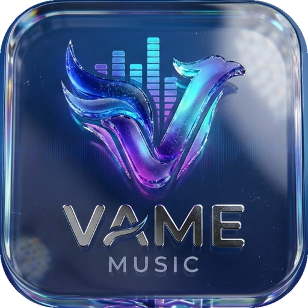

  

<h1 align="center">VAME Music</h1>

  A free, open-source music player for Android. No ads, no accounts, no tracking. 
  Made by <a href="https://www.instagram.com/vxvekggs/">@vxvekggs</a>

---

## Features

- Search and play songs, with a full Now Playing page, synced lyrics (and Hinglish lyrics) and an Up next queue
- Home, Search, Your Type and Library pages. Home shows music only (no "Top 100 hits" style compilations)
- Your Type: suggestions built from what you listen to and the genres you pick
- Playlists with your own name and cover photo, liked songs, liked artists, artist and album pages
- Import a playlist from YouTube Music, YouTube or Spotify (link), or paste a list of songs
- Offline downloads with a choice of quality
- Sleep timer, play N times, loop, shuffle, playback speed, skip silence
- Choose the sound output (phone, Bluetooth, headphones)
- "Official songs only" switch that hides remixes, slowed + reverb and lyric-channel uploads
- Lock screen / notification controls

See [CHANGELOG.md](CHANGELOG.md) for everything, version by version.

## Install

1. Open the **Actions** tab, tap the latest green run, and download the **VAME-debug-apk** file at the bottom.
2. Unzip it and install the APK (allow "install from unknown sources" when Android asks).

Or grab the APK from the **Releases** page when one is published.

Needs Android 8.0 (API 26) or newer.

## Build it yourself

You only need GitHub: push to `main` and the workflow in `.github/workflows/build.yml` builds the APK for you.

On a computer: install JDK 17 and Gradle 8.10, then run `gradle assembleDebug`.
The APK is created in `app/build/outputs/apk/debug/`.

## Built with

Kotlin, Jetpack Compose, AndroidX Media3 (ExoPlayer), Coil, OkHttp and
[NewPipeExtractor](https://github.com/TeamNewPipe/NewPipeExtractor).
Full list with licenses: [THIRD_PARTY_LICENSES.md](THIRD_PARTY_LICENSES.md).

## Please read

- VAME is **not affiliated with YouTube, Google, Spotify or Apple**. See [DISCLAIMER.md](DISCLAIMER.md).
- Your data stays on your phone. See [PRIVACY.md](PRIVACY.md).
- Want to help or report a problem? See [CONTRIBUTING.md](CONTRIBUTING.md) and [SECURITY.md](SECURITY.md).

## License

VAME Music is free software under the **GNU General Public License v3.0** (see [LICENSE](LICENSE)).
The interface is inspired by AmeOS 16 by the AmeOS team (CC BY 4.0).

## Follow

Instagram: [@vxvekggs](https://www.instagram.com/vxvekggs/)
